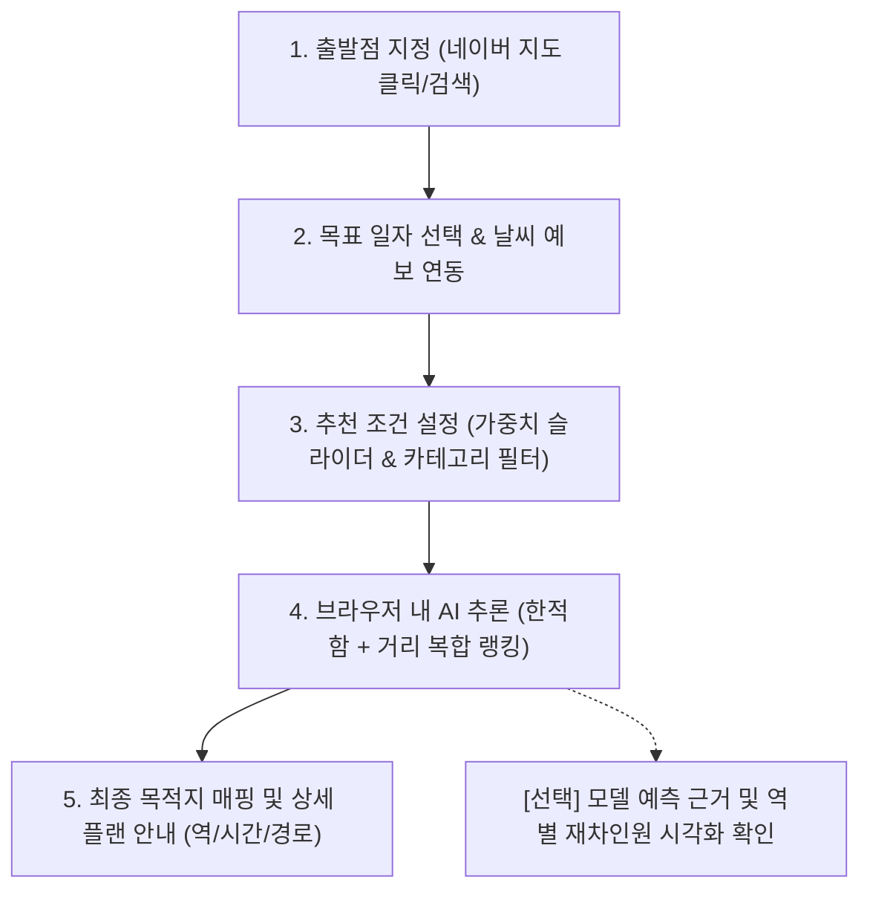

# 🚇 대전 맞춤형 한적한 이동 추천 웹 서비스 (Daejeon Metro Quiet Route)

> **"대전에서 가장 여유롭고 쾌적한 이동 경로를 찾아드립니다."**  
> 대전광역시의 위치 기반 지도(네이버 지도), 실시간 기상 예보, 그리고 물리 법칙 기반 머신러닝으로 정밀 학습된 **대전 도시철도 1호선 열차별 재차인원(혼잡도) 예측 모델**을 결합하여, 도서관·공원·서점·산책로 등 한적한 장소로 떠나는 최적의 출발역·시간대·목적지 이동 플랜을 추천하는 웹 애플리케이션입니다.

---

## 📌 1. 프로젝트 비전 및 목표 (Project Goals)

- **지역적 범위**: 대한민국 **대전광역시** (대전 도시철도 1호선 22개 역 및 대전 전역 한적한 명소).
- **핵심 가치**:
  1. **한적함 (Quiet & Relaxing)**: 붐비지 않는 열차와 여유로운 힐링 목적지(도서관, 공원, 서점, 전시관, 산책로 등) 연계.
  2. **접근성 (Convenience)**: 사용자가 지정한 출발 위치로부터 가장 효율적인 지하철역 탐색.
  3. **사용자 맞춤성 (Customizable)**: '한적함 우선' vs '가까운 역 우선' 가중치 슬라이더 및 테마별 필터 제공.
  4. **투명성 (Explainable AI)**: 물리 법칙과 AI 모델이 산출한 열차 재차인원과 혼잡도 근거를 인터랙티브 시각화로 확인 가능.
  5. **경량화 및 무서버 운영 (Serverless Static Web)**: 무거운 백엔드 서버 없이, **웹 브라우저(JavaScript / WebAssembly)에서 클라이언트 사이드로 AI 모델이 직접 추론**되어 GitHub Pages만으로 완전 무료 호스팅 가능.

---

## 🚶‍♂️ 2. 사용자 시나리오 및 이용 흐름 (User Journey)



### [Step 1] 대전 지도 상 출발점 지정
- **네이버 지도 API (Naver Maps Web SDK v3)** 인터페이스를 통해 사용자가 원하는 출발 위치를 클릭하거나 주소 검색으로 핀포인트를 지정합니다.
- 출발 좌표와 대전 1호선 22개 역의 좌표를 계산하여 각 역까지의 직선 거리 및 도보 소요 시간을 산출합니다.

### [Step 2] 방문 목표 일자 지정 및 날씨 예보 획득
- 사용자가 외출/방문 목표 일자(`YYYY-MM-DD`)를 캘린더에서 선택합니다.
- 날씨 예보 API(기상청 단기예보 또는 Open-Meteo)를 자동 호출하여 해당 일자의 기상 요인(**기온, 강수량, 적설량**)을 획득하고 AI 모델의 입력값으로 반영합니다.

### [Step 3] 가중치 조절 및 목적지 필터링
- **슬라이더 조절**: *"한적함 우선(여유로운 열차 선호)"* $\longleftrightarrow$ *"가까운 역 우선(빠른 이동 선호)"* 가중치 비중($w_1, w_2$)을 직접 설정합니다.
- **카테고리 필터**: 원하는 한적한 목적지 테마를 선택합니다.
  - `[전체]` `[📚 도서관]` `[🌳 공원]` `[📖 서점/북카페]` `[🖼️ 전시관/미술관]` `[🏛️ 문화시설]` `[👟 산책로]`

### [Step 4] 브라우저 내 AI 추론 및 추천 순위 도출
- 별도의 백엔드 호출 없이, **웹 브라우저에서 구동되는 클라이언트 머신러닝 엔진(ONNX Web Runtime / JS Decision Tree)**이 22개 역, 상/하행 방향, 시간대별 재차인원을 즉시 계산합니다.
- **다목적 복합 스코어링 공식**:
  $$\text{Score} = w_{\text{quiet}} \cdot \left(1 - \frac{\text{Load}}{\text{Max\_Capacity}}\right) + w_{\text{dist}} \cdot \left(1 - \frac{\text{Distance}}{\text{Max\_Distance}}\right)$$
- 최적의 출발역 및 시간대 Top-N 추천 리스트를 카드 형태로 제시합니다.

### [Step 5] 목적지 후보 연계 최종 이동 플랜 안내
- 추천 카드 중 하나를 선택하면, 해당 역 인근의 한적한 목적지 후보군을 매핑하여 구체적인 행동 가이드를 제공합니다:
  > **추천 플랜 예시**:  
  > *"오후 2시 10분에 도보 8분 거리인 **[정부청사역]**에서 하행선 열차를 타시면 재차인원 약 65명(좌석 여유)으로 매우 쾌적합니다. **[월평역]**에서 하차하여 **[은구비공원 및 갈마도서관 산책로]**로 이동하는 코스를 추천합니다."*

---

## 🏛️ 3. 목적지 후보군 데이터 구성 (Quiet Destinations)

대전 도시철도 1호선 역세권과 연계된 조용하고 여유로운 장소 데이터셋(`data/destinations.json`)을 구축하여 제공합니다.

| 카테고리 | 대표 추천 장소 후보군 예시 | 연계 지하철역 |
| :--- | :--- | :--- |
| **📚 도서관** | 한밭도서관, 갈마도서관, 유성도서관, 노은도서관, 대전평생학습관 | 서대전네거리역, 갈마역, 유성온천역, 노은역, 중구청역 |
| **🌳 공원** | 한밭수목원, 남선공원, 샘머리공원, 유림공원, 은구비공원 | 정부청사역, 탄방역, 시청역, 유성온천역, 노은역 |
| **📖 서점/북카페** | 계룡문고, 대전 원도심 독립서점 거리, 유성 북카페 거리 | 중앙로역, 대전역, 유성온천역 |
| **🖼️ 전시/문화** | 대전시립미술관, 이응노미술관, 대전예술의전당, 옛 충남도청 근현대사전시관 | 정부청사역, 만년동 연계, 중구청역 |
| **👟 산책로** | 갑천변 생태산책로, 유등천변 산책로, 대전천 벚꽃길, 국립대전현충원 보훈둘레길 | 갑천역, 용문역, 대동역, 현충원역 |

---

## 🧠 4. AI 모델 아키텍처 및 클라이언트 구동 방식

### 4.1 2단계 하이브리드 모델 개요
1. **1단계 (물리 제약 수치 최적화)**:
   - 지상 센서 실측 데이터가 없는 한계를 극복하기 위해, **"종점 잔류 인원 0", "재차인원 $\ge 0$", "출발역 하차 0"**의 물리 보존 법칙을 손실함수($\mathcal{L}$)로 정의하여 상/하행 분배율 로짓을 PyTorch Adam으로 최적화 복원.
2. **2단계 (고속 GBDT 예측 머신러닝)**:
   - 복원된 정답 데이터를 기반으로 `HistGradientBoostingRegressor`를 학습.
   - 피처: `정차역`, `시간(5~24)`, `방향(상/하행)`, `주말/공휴일`, `기온`, `강수량`, `적설량`, `시각표 버전`
   - 검증 $R^2 = 0.84$, 하루 5,281회 정차 시점 배치 추론에 0.05초 소요.
   - 세부 수식 및 이론: [`docs/AI/METHODOLOGY.md`](docs/AI/METHODOLOGY.md) 참조.

### 4.2 웹(브라우저) 실행 방식: 왜 JavaScript / ONNX Web인가?
- 사용자의 모든 미래 조건(임의 날짜, 임의 시간, 임의 날씨)을 미리 다 계산해 둘 수는 없습니다.
- 하지만 **GBDT 의사결정 트리 모델은 수학적으로 수많은 if-else 분기문과 임계값(Threshold) 비교의 집합**이므로, 굳이 무거운 파이썬 서버를 띄우지 않아도 브라우저에서 초고속으로 연산할 수 있습니다.
- **운영 아키텍처 (Client-side Inference)**:
  ```
  [개발자/배포자]
    - 1주~1달 간격 모델 재학습 (Python)
    - 학습 완료된 모델을 경량 웹 포맷(ONNX 또는 JSON 트리 가중치, ~1MB)으로 내보내기
           │
           ▼
  [GitHub Pages (정적 호스팅)] ──(가중치 정적 다운로드)──> [사용자 웹 브라우저 (JS)]
                                                                  │
                                                          [ONNX Web Runtime]
                                                                  │
                                                       (단 0.001초 만에 재차인원 추론)
  ```
- **장점**:
  - **서버 비용 0원**: 백엔드 서버 호스팅비가 전혀 발생하지 않음.
  - **무제한 트래픽**: GitHub Pages의 정적 CDN을 통해 전송되므로 서버 다운 걱정이 없음.
  - **개인정보 보호**: 사용자의 지도 클릭 위치가 외부 서버로 전송되지 않고 브라우저 내부에서만 처리됨.

---

## 📊 5. 모델 근거 시각화 대시보드 (Explainable AI)

사용자가 추천 결과를 맹목적으로 믿는 것이 아니라 직접 납득할 수 있도록 시각화 탭을 제공합니다:
1. **역/시간별 혼잡도 히트맵 (Heatmap)**: 대전 1호선 22개 역의 하루(5~24시) 혼잡도 패턴을 한눈에 조망.
2. **열차 재차인원 궤적 곡선 (Trajectory Chart)**: 판암역 출발부터 반석역 종점까지 이동하며 변화하는 승객 수 곡선.
3. **혼잡도 등급 가이드**:
   - `여유` (<80명) | `보통` (80~180명) | `약간 혼잡` (180~300명) | `혼잡` (>300명, 정원 450명 대비).

---

## 💻 6. 기술 스택 및 프로젝트 구조

### 기술 스택
- **프론트엔드**: HTML5, Modern JavaScript (ES6+), CSS3 (Tailwind CSS 또는 Vanilla CSS)
- **지도 연동**: 네이버 지도 Web API (v3)
- **클라이언트 ML 추론**: `onnxruntime-web` (WebAssembly 가속) 또는 Pure JS Decision Tree Parser
- **데이터 시각화**: Chart.js 또는 Plotly.js
- **배포 플랫폼**: **GitHub Pages** (또는 GitLab Pages)

### 디렉터리 구조
```text
├── README.md                      # [본 문서] 프로젝트 종합 안내 및 비전
├── docs/                          # 상세 설계 문서
│   └── AI/                        # AI 모델링 세부 명세서 (METHODOLOGY, MODEL 등)
├── outputs/                       # 파이썬 모델 가중치 및 데이터
│   ├── load_predictor.joblib      # scikit-learn 원본 모델 가중치
│   ├── load_predictor.onnx        # [웹 배포용] 브라우저 실행용 경량 ONNX 가중치 (~1MB)
│   └── ground_truth_train_loads.csv # 1단계 최적화 복원 정답셋
├── data/                          # 서비스 데이터
│   ├── destinations.json          # [신규] 대전 한적한 명소(도서관/공원/서점 등) 데이터셋
│   └── stations.json              # 대전 1호선 22개 역 위경도 및 메타데이터
├── scripts/                       # 데이터 전처리 및 변환 도구
│   ├── convert_model_to_onnx.py   # joblib 모델을 onnxruntime-web 포맷으로 변환
│   └── utils/                     # 기상청 날씨 데이터 수집기
├── web/                           # [웹 애플리케이션 프론트엔드 (GitHub Pages 배포 디렉터리)]
│   ├── index.html                 # 메인 웹페이지 (지도, 추천 카드, 슬라이더)
│   ├── app.js                     # 네이버 지도 연동 및 이벤트 컨트롤러
│   ├── model_runner.js            # 브라우저 내 ONNX/JS 머신러닝 추론 엔진
│   ├── visualizer.js              # 재차인원 히트맵/차트 시각화 모듈
│   └── style.css                  # 모던 반응형 스타일시트
├── predict_load.py                # 파이썬 CLI 단일 추론 인터페이스
├── extract_train_loads.py         # 일자별 열차 궤적 일괄 추출기
└── train_predict_model.py         # 2단계 GBDT 모델 학습 스크립트
```

---

## 🚀 7. 마일스톤 및 개발 계획 (Roadmap)

- [x] **Phase 1: 데이터 복원 및 예측 모델 학습 완료**
  - 대전 1호선 물리 제약 최적화 완료, GBDT 재차인원 예측 모델 구축 (`load_predictor.joblib`).
- [ ] **Phase 2: 웹 추론 변환 및 데이터셋 준비**
  - `load_predictor.joblib` $\to$ 브라우저용 `load_predictor.onnx` 변환 스크립트 작성.
  - 대전 1호선 22개 역 위경도(`stations.json`) 및 한적한 목적지 후보(`destinations.json`) 구축.
- [ ] **Phase 3: 네이버 지도 및 UI 컴포넌트 개발**
  - 네이버 지도 SDK 연동 (출발지 마커 핀포인트).
  - 한적함-거리 가중치 슬라이더, 카테고리 필터 태그, 날짜 캘린더 피커 구현.
- [ ] **Phase 4: 브라우저 인퍼런스 및 추천 알고리즘 결합**
  - 클라이언트 사이드 추론 연동, 복합 추천 스코어링 산출 및 추천 카드 UI 출력.
- [ ] **Phase 5: 재차인원 시각화 탭 및 GitHub Pages 배포**
  - 역별/시간별 혼잡도 히트맵 차트 추가.
  - GitHub Pages 배포 및 모바일/PC 반응형 검증.
